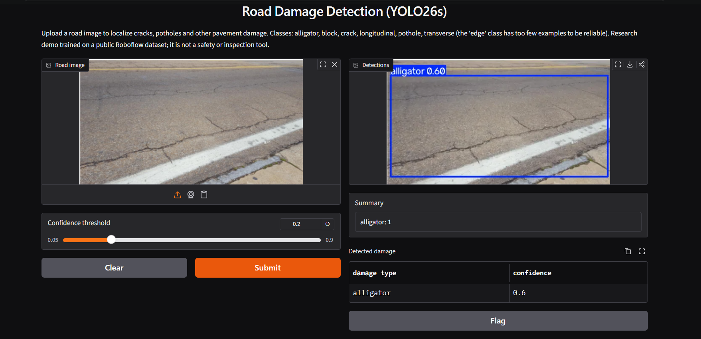

# Road Damage Detection with YOLO

Object detection of road surface damage (cracks, potholes and related types) with three YOLO generations
(YOLOv8s, YOLO11s, YOLO26s), trained under identical settings and compared on the same data. The best model
(YOLO26s) is served through a small Gradio app.

**Notebook (data audit, cleaning, training, evaluation):** [Kaggle notebook](https://www.kaggle.com/code/asafesmat/road-damage-object-detection)


*Example output of the Gradio app on an image from the validation split.*


## Summary

- **Task:** detect and localize 7 road damage classes in images.
- **Models compared:** YOLOv8s, YOLO11s, YOLO26s (small variants, COCO-pretrained, 30 epochs each).
- **Best model:** YOLO26s. On the validation split it reaches mAP50 = 0.417 and mAP50-95 = 0.245, ahead of
  YOLOv8s (0.400 / 0.227) and YOLO11s (0.398 / 0.228). It also has the best mAP50-95 in all six classes that can be evaluated.
- **Data cleaning matters:** about 10% of the validation images and 16% of the test images had a near-identical
  copy in the training set. These copies were removed before any result below was produced.
- **Honest caveats:** one training run (one seed) per model, limited hyperparameter tuning, and one class (`edge`)
  with too few examples to evaluate. See [Limitations](#limitations).

## Dataset

- **Source:** [road-damage](https://universe.roboflow.com/trafficsignssafeway/road-damage-l1ju7) on Roboflow Universe
  by TrafficSignsSafeway, licensed CC BY 4.0. Exported in YOLOv8 format (version 2 of a fork).
- **Size:** 6,757 images (train 4,930 / valid 1,146 / test 681). The images are a mix of top-down views and
  dashcam-style views, many of them low resolution.
- **Classes:** `alligator`, `block`, `crack`, `edge`, `longitudinal`, `pothole`, `transverse`.

| Class | Train boxes | Valid boxes | Test boxes |
|---|---:|---:|---:|
| alligator | 4,324 | 997 | 577 |
| block | 305 | 86 | 47 |
| crack | 1,768 | 216 | 93 |
| edge | 21 | 1 | 0 |
| longitudinal | 2,008 | 548 | 311 |
| pothole | 6,051 | 1,595 | 909 |
| transverse | 484 | 126 | 67 |

(Counts are for the raw export, boxes only.) The classes are strongly imbalanced, and `edge` has no test
instances at all, so its AP is undefined on the test split.

## Data cleaning

Two problems were found by auditing the raw export (see the [Kaggle notebook](https://www.kaggle.com/code/asafesmat/road-damage-object-detection)):

1. **Mixed label formats.** 25 train and 10 validation label files contain polygon rows next to box rows.
   Ultralytics silently drops the images whose files mix both formats. Polygons were converted to their
   bounding boxes instead, and boxes were clamped to the image.
2. **Near-duplicate images across splits.** Matching file names was not reliable, so each image got a 64-bit
   difference hash (dHash, 9×8 grayscale) and was compared by Hamming distance, including horizontally flipped
   versions. Visual checks of pairs at 4–6 bits showed the same picture, cropped, rescaled or re-lit.
   - 9.9% of validation and 16.0% of test images were within 2 bits of a training image
     (19.1% / 27.8% within 6 bits).
   - A threshold of 8 bits was used. It removes 860 training images (any training image close to a validation
     or test image) and 151 validation images (close to a test image).
   - Cleaned split: **train 4,070 / valid 995 / test 681**. The test set was not modified.

The threshold of 8 bits is deliberately conservative: in a visual check of borderline cases (7–8 bits), two of
three pairs turned out to be different images, so some legitimate images were removed too. This cost the rare
classes the most (training boxes of `transverse` dropped from 484 to 275). Near-duplicates that dHash cannot
match (for example rotated or heavily cropped copies) may remain.

## Training setup

| Setting | Value |
|---|---|
| Framework | Ultralytics 8.4.189, PyTorch 2.11 |
| Hardware | NVIDIA Tesla T4 (Google Colab for the first set of runs, Kaggle for the second) |
| Init | COCO-pretrained `yolov8s.pt`, `yolo11s.pt`, `yolo26s.pt` |
| Epochs / patience | 30 / 10 (no run stopped early) |
| Image size / batch | 640 / 16 |
| Seed | 0 (rerunning the YOLOv8s baseline reproduced the same metrics exactly) |
| Other | Ultralytics defaults (including `optimizer=auto`, mosaic, standard augmentations) |

## Results

### Model comparison (validation split, cleaned data, Colab T4)

All three models: same data, same settings, default NMS IoU (0.7).

| Model | mAP50 | mAP50-95 | Precision | Recall | Params | GFLOPs | File size | Training time |
|---|---:|---:|---:|---:|---:|---:|---:|---:|
| YOLOv8s | 0.400 | 0.227 | 0.614 | 0.384 | 11.13M | 28.4 | 22.5 MB | ~0.8 h |
| YOLO11s | 0.398 | 0.228 | 0.614 | 0.389 | 9.42M | 21.4 | 19.2 MB | ~0.8 h |
| **YOLO26s** | **0.417** | **0.245** | 0.618 | 0.395 | 9.47M | 20.8 | 20.3 MB | ~0.9 h |

Parameters and GFLOPs are for the fused inference model. mAP50-95 averages the AP over IoU thresholds from 0.50
to 0.95, so it reflects box localization quality; no separate mean-IoU metric was computed.

Per-class AP50 on the same validation split:

| Class | YOLOv8s | YOLO11s | YOLO26s |
|---|---:|---:|---:|
| alligator | 0.352 | 0.364 | 0.370 |
| block | 0.829 | 0.794 | 0.829 |
| crack | 0.244 | 0.280 | 0.283 |
| longitudinal | 0.232 | 0.221 | 0.248 |
| pothole | 0.593 | 0.595 | 0.630 |
| transverse | 0.547 | 0.530 | 0.560 |
| edge | 0.000 | 0.000 | 0.000 |

`edge` has a single validation instance, so its 0.000 says very little. Validation `block` AP rests on only
73 boxes.

Per-class mAP50-95 on the same validation split (YOLO26s is highest in every evaluable class):

| Class | YOLOv8s | YOLO11s | YOLO26s |
|---|---:|---:|---:|
| alligator | 0.181 | 0.181 | 0.188 |
| block | 0.631 | 0.622 | 0.657 |
| crack | 0.120 | 0.144 | 0.152 |
| longitudinal | 0.095 | 0.088 | 0.104 |
| pothole | 0.305 | 0.305 | 0.330 |
| transverse | 0.257 | 0.256 | 0.285 |

### Second run: trained and evaluated on Kaggle (T4, NMS IoU 0.5)

YOLO11s and YOLO26s were trained a second time (same settings and seed, different environment) in one Kaggle
notebook, which also evaluated them on the test split. **The deployed weights come from this run.** The YOLOv8s
weights from that notebook were an unfinished checkpoint, so YOLOv8s is **not** evaluated on the test split.
Differences from the Colab table above (for example YOLO26s 0.423 vs 0.417) mix run-to-run variation with the
change of NMS IoU from 0.7 to 0.5, and the two cannot be separated.

| Model | Split | mAP50 | mAP50-95 | mAP50 without `edge` | Precision | Recall | FPS (batch 1) |
|---|---|---:|---:|---:|---:|---:|---:|
| YOLO11s | valid | 0.411 | 0.226 | 0.479 | 0.604 | 0.414 | |
| YOLO26s | valid | 0.423 | 0.244 | 0.494 | 0.601 | 0.418 | |
| YOLO11s | test | 0.573 | 0.332 | 0.573 | 0.576 | 0.567 | 65.5 |
| YOLO26s | test | 0.596 | 0.348 | 0.596 | 0.578 | 0.573 | 65.7 |

How to read this table:

- Validation mAP averages 7 classes (`edge` counts as 0), while test mAP averages the 6 classes that have test
  instances. The "without `edge`" column puts both on the same 6 classes.
- **Test scores are much higher than validation scores** even on the same 6 classes (for example `crack`
  AP50 is about 0.88 on test and 0.28 on validation). The cause was not investigated: the test set may simply
  be easier, or near-duplicates that the hashing cannot detect may remain. Treat the validation numbers as the
  conservative estimate and do not read the test numbers as the expected real-world accuracy.
- FPS is end-to-end (image read, preprocessing, model, postprocessing) at batch size 1 and is nearly identical
  for both models, so speed is not a differentiator here. YOLOv8s was not benchmarked.

## Tuning experiments

What was actually tried (YOLOv8s, validation split, cleaned data):

| Experiment | Result |
|---|---|
| 50 epochs instead of 30 | mAP50 0.393 vs 0.400, mAP50-95 0.225 vs 0.227: no gain, 33 minutes more training |
| NMS IoU sweep at inference (0.3 / 0.4 / 0.5 / 0.7) | mAP50 0.405 / 0.413 / 0.414 / 0.400; mAP50-95 0.219 / 0.222 / 0.225 / 0.227 |
| Inference at 800 px with weights trained at 640 px | Worse (mAP50-95 about 0.17 vs 0.227) |

NMS IoU 0.5 was chosen on the validation split. It gives about +0.014 mAP50 for YOLOv8s at no training cost, and
it was applied to the Kaggle evaluation above. It was not swept for YOLO11s, and YOLO26s is designed to run
without NMS, so the setting may have no effect on it (not verified).

**Not done:** a training-time hyperparameter search (learning rate, augmentation strength, loss weights),
multiple seeds, and larger model variants. Earlier experiments run before the duplicate removal were discarded
because they were measured on a leaky validation split.

## Error analysis

From the normalized confusion matrix of the YOLOv8s baseline on the validation split (computed with a very low
confidence threshold):

- Most objects are found: the diagonal is 0.71 (`crack`) to 0.90 (`pothole`), and missed objects are at most 0.13.
- Confusion between classes is small, except `block` predicted as `alligator` (0.10).
- The main weakness is false positives, mostly labelled `alligator`, `pothole` and `longitudinal`.

A visual comparison of labels and predictions on one validation batch (16 tiles, not a systematic study) showed
that `alligator` and `block` labels are not applied consistently, and some predictions on visible cracks had no
matching label. Label noise is therefore a likely contributor to the low AP of `crack`, `longitudinal` and
`alligator`, but this was not measured.

## Limitations

- One training run per model with a single seed: differences of about 0.01–0.02 mAP50 should not be over-read.
  The YOLO26s lead in mAP50-95 (+0.018 over YOLOv8s on validation, positive in all six evaluable classes) is the most
  consistent signal.
- `edge` (21 training boxes, 1 validation, 0 test) is unreliable and effectively never predicted.
- `crack` and `longitudinal` are weak (validation AP50 of about 0.22–0.28).
- Duplicate removal is approximate (hash-based, 8-bit threshold) and the validation/test gap is unexplained.
- The data mixes aerial and dashcam images from different sources, so performance on other camera setups is unknown.
- The model was developed for a course project and is **not** a safety or road inspection tool.

## Demo app

A Gradio app (`app.py`) loads the YOLO26s weights, takes an image, and returns the annotated image, a per-class
summary, and a table of detections. The confidence threshold is adjustable (default 0.25).

```bash
pip install -r requirements.txt
python app.py
```

Then open the local URL printed in the terminal (usually http://127.0.0.1:7860). The app looks for the weights
at `weights/best.pt` (or `best.pt` next to `app.py`, or the path in the `MODEL_PATH` environment variable).
Running on CPU is slower than the GPU figures above.

## Repository structure

```
.
├── app.py              # Gradio demo
├── requirements.txt
├── weights/best.pt     # YOLO26s weights (about 20 MB)
└── README.md
```

The training and evaluation notebook is published on Kaggle instead of in this repository (link at the top).

## Reproducing the results

1. Get the dataset from the Roboflow Universe link above (YOLOv8 export, version 2). Do not commit a Roboflow API
   key; keep it in Colab/Kaggle Secrets.
2. Open the [Kaggle notebook](https://www.kaggle.com/code/asafesmat/road-damage-object-detection) on a GPU runtime, attach the dataset as an input and run it
   from the top. It audits the data, builds the cleaned copy, trains the baselines and evaluates them.

The published notebook corresponds to the second run (Kaggle). The numbers in the first comparison table come from
earlier runs of the same pipeline on Colab, whose notebook is not published. The pipeline is deterministic for a
given environment, but small differences between Colab and Kaggle are possible.

## License and attribution

- Dataset: "road-damage" by TrafficSignsSafeway on Roboflow Universe, CC BY 4.0. Attribution is required; the
  dataset itself is not redistributed in this repository.
- Models and code build on [Ultralytics](https://github.com/ultralytics/ultralytics), which is released under the
  AGPL-3.0 license. This repository is released under AGPL-3.0 as well, for consistency (see `LICENSE`).

## Author

Asaf Esmat Wagih ([GitHub](https://github.com/asafesmat), [LinkedIn](https://linkedin.com/in/asaf-esmat),
[Kaggle](https://kaggle.com/asafesmat))
